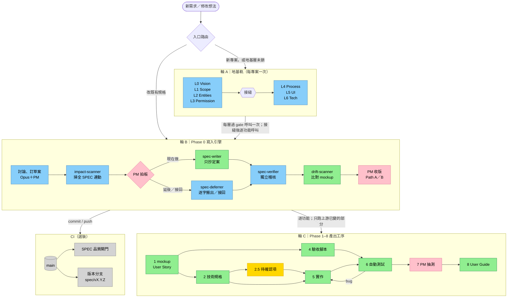

# Spec-driven Agent Workflow

[English](README.md) · **繁體中文**

> 一套給 PM 用 Claude Code「從零到有設計一個系統」的 spec-driven 工作流：
> **人決策、AI 執行與稽核**，並依任務難度分配模型等級。

這個資料夾（`agent-workflow/`）收錄的是**方法論本身**：工作流規則書（`workflow/`）與 12 個 Claude Code subagent 定義（`agents-setup/`），另附 1 個 slash command（`commands/`）、3 個 skill（`skills/`）與 2 份配方（`recipes/`：SPEC 版本分支、SPEC 品質閘門，皆附腳本與測試）。規則書索引見 [`workflow/README.md`](workflow/README.md)。
目前是展示版（v0.1）：專案 template、起手腳本與部分輔助腳本尚未包含；規則書標「未包含於此 repo」的腳本請視為設計說明。SPEC CI 檢查已收在 `recipes/`。

---

## 核心想法

**認知分工：誰做什麼**

| 認知動作 | 誰 |
|---|---|
| 訂規格、做決策、推理、解分岔；掃連動、獨立稽核 | 🔵 **Opus + PM** |
| 備料（攤選項、情境矩陣）、**寫入**（抄定稿）、drift 檢查、跑測試 | 🟢 Sonnet |
| 輕量整理（待確認項、mock 值） | 🟡 Haiku |
| 拍板、收版、人工抽測 | 👤 PM |

> 一句話：**訂／掃連動／稽核 = Opus｜寫／drift／測試 = Sonnet｜輕量整理 = Haiku｜拍板／抽測 = 人。**
> 寫入規格的 agent 永遠只「抄」已決定的內容，它不訂任何規格；凡是「訂」都走 Opus 加上 PM。

**🚦 Token Gate**：會大量消耗 token 的節點（實作、產測試、跑測試、批次展開），開跑前先回報「範圍與規模預估」，等 PM 同意才執行；預設一次只跑一個功能。

**Vendoring（自足）**：起新專案時把 `workflow/` 與 `agents-setup/` 複製進專案的 `.claude/`。專案交給別人的 Claude 也能照同一套流程跑，不需要安裝這個資料夾。

---

## 三軸模型

工作流不是單一線性順序，而是三條軸互相「呼叫」：



顏色：🔵 藍＝Opus（含與 PM 一起訂）｜🟢 綠＝Sonnet｜🟡 黃＝Haiku｜🩷 粉＝PM｜灰＝CI 自動跑（不呼叫 LLM）。延後的功能經 spec-deferrer 搬移。

- **軸 A｜地基軌**：逐層拍板 Vision、Scope、Entities（含 Glossary＝唯一名詞來源）、Permission、Process、UI、Tech。每層過 gate＝跑一次 Phase 0。見 [`workflow/foundation-track.md`](workflow/foundation-track.md)。
- **軸 B｜Phase 0 決策寫入引擎**：所有規格異動都走這裡。見 [`workflow/phase-0-spec-update.md`](workflow/phase-0-spec-update.md)。
- **軸 C｜Artifact 工序**：按需組裝，只重跑上游有變動的部分。
- **入口路由**：收到一個需求該走哪條軌，見 [`workflow/entry-routing.md`](workflow/entry-routing.md)。

### 兩遍法

接縫後逐功能展開時：
- **第一遍**：由 Sonnet 用預設答案把明確的部分填滿，有分岔的地方標 `⏳`，這一遍不佔用 Opus。
- **第二遍**：Opus 只處理那些 `⏳`，逐項定稿。

地基期 Opus 負載重，地基鎖定後多半只是套用既有慣例，Opus 負載變輕。

---

## Phase 0：一筆規格異動怎麼進 SPEC

| 步驟 | 做什麼 | 誰 |
|---|---|---|
| 討論前彙整 | 把備料整理成議程 | 🟢 |
| 訂規格定稿 | 逐項決策、解分岔 | 🔵 + 👤 |
| impact-scan | 關鍵詞自擴 ≥30 詞，掃全 SPEC 的強／弱／無連動，並檢查八個面向：術語、API、權限、狀態機、跨 spec 一致性、彙總層同步、同表全列重讀、死路 | 🔵 |
| PM 拍板 | 看完掃描結果後決定 | 👤 |
| spec-writer 寫入 | 抄定稿進 feature 文件；**沒有掃描結果就拒寫**；寫完輸出 JSON 自報 | 🟢 |
| （延後時）spec-deferrer 搬移 | PM 拍板「延後」的功能，逐字搬到 `Spec/Deferred/`，正文留保留編號佔位並記接回清單；之後可依錨點原樣接回 | 🔵 |
| spec-verifier 稽核 | 用三個來源交集比對：議題、強連動、diff 反推；機器複驗自報；機械性偏差自動修正；名詞 lint；檢查決策檔與接回錨點 | 🔵 |
| 收版 | Path A：單一 commit；Path B：feature branch 兩個 commit | 👤 |

**SPEC 生命週期**：正文只寫現行行為；每次異動都新增一份決策檔（結論、Why、否決的方案、推翻了什麼），並綁定工作項；延後的功能搬進 `Spec/Deferred/`，不留在正文。既有編號永不重編，退役或延後的編號保留不重用。見 [`workflow/phase-0-spec-update.md`](workflow/phase-0-spec-update.md) §SPEC 生命週期。

**SPEC 版本分支**：SPEC 一律寫在 `main`，但 `main` 常同時放好幾版的行為。宣告啟用的專案，每個開發中的 milestone 一條 `spec/vX.Y.Z` 分支，CI 依工作項的 milestone 把 `main` 的 commit 挑進該挑的分支；RD／QA 讀分支就拿到「這版完整的行為」，release 打 tag 後凍結。規則見 §SPEC 生命週期 7，安裝與操作見 `recipes/` 資料夾：[`recipes/spec-version-branches.md`](recipes/spec-version-branches.md)（同步腳本、測試與 CI 片段在 [`recipes/spec-version-branches/`](recipes/spec-version-branches/)）。

**SPEC 品質閘門**：九項確定性 CI 檢查（禁用名詞、正文字樣、限定詞、編號、通知信、mockup、commit 工作項、決策檔 schema 與檢視），純 Python、不呼叫 LLM。見 [`recipes/spec-ci-gates.md`](recipes/spec-ci-gates.md)。

**寫程式的驗證流程**：改到程式碼的工作都照 [`workflow/verification.md`](workflow/verification.md)：驗收劇本由非實作者先寫、實作方不得修改、漏網的 bug 變成規則。

## 12 個 agents

| Agent | Phase | 角色 | Model |
|---|---|---|---|
| [`phase0-impact-scanner`](agents-setup/phase0-impact-scanner.md) | 0 | 拍板前掃全 SPEC，回報強／弱／無連動 | opus |
| [`phase0-spec-writer`](agents-setup/phase0-spec-writer.md) | 0 | 把定案寫入 SPEC，輸出 JSON 自報 | sonnet |
| [`phase0-spec-verifier`](agents-setup/phase0-spec-verifier.md) | 0 | 獨立稽核，並自動修正機械性偏差 | opus |
| [`phase0-mockup-drift-scanner`](agents-setup/phase0-mockup-drift-scanner.md) | 0 | 掃 mockup／流程圖與 SPEC 的 drift | sonnet |
| [`phase0-spec-deferrer`](agents-setup/phase0-spec-deferrer.md) | 0 | 延後功能逐字搬出 SPEC，之後依錨點接回 | opus |
| [`phase1-product-designer`](agents-setup/phase1-product-designer.md) | 1 | 產出標註版 mockup HTML 與 User Story | sonnet |
| [`phase2-tech-spec`](agents-setup/phase2-tech-spec.md) | 2 | 推導 DB／API／狀態機 | sonnet |
| [`phase25-pending-manager`](agents-setup/phase25-pending-manager.md) | 2.5 | 整理待確認項目與 mock 值 | haiku |
| [`phase4-test-writer`](agents-setup/phase4-test-writer.md) | 4 | AC → coverage matrix → YAML 測試案例 | sonnet |
| [`phase5-dev-builder`](agents-setup/phase5-dev-builder.md) | 5 | 實作（保留 `data-action` 供測試使用） | sonnet |
| [`phase6-test-runner`](agents-setup/phase6-test-runner.md) | 6 | 跑自動測試、截圖、出報告 | sonnet |
| [`phase8-guide-writer`](agents-setup/phase8-guide-writer.md) | 8 | 產出 User Guide | sonnet |

Phase 7 是人工抽測，由 PM 自己跑。Phase 3（Mockup）已併入 Phase 1。

## 規則書索引

分組索引與建議閱讀順序見 [`workflow/README.md`](workflow/README.md)。

| 檔案 | 內容 |
|---|---|
| [`entry-routing.md`](workflow/entry-routing.md) | 需求進來走哪條軌 |
| [`foundation-track.md`](workflow/foundation-track.md) | 軸 A 地基軌 L0–L6 |
| [`phase-0-spec-update.md`](workflow/phase-0-spec-update.md) · [`phase-0-impact-scan.md`](workflow/phase-0-impact-scan.md) | 軸 B 決策寫入引擎 |
| [`phase-1-product-design.md`](workflow/phase-1-product-design.md) ～ [`phase-8-userguide.md`](workflow/phase-8-userguide.md) | 軸 C 各階段 |
| [`CONTRACTS.md`](workflow/CONTRACTS.md) · [`SPEC_NUMBERING_RULES.md`](workflow/SPEC_NUMBERING_RULES.md) · [`CROSSLINK_REGEN.md`](workflow/CROSSLINK_REGEN.md) · [`GUIDE_SECTIONS.md`](workflow/GUIDE_SECTIONS.md) | 交棒契約、編號、交叉連結、Guide 章節 |
| [`file-discipline.md`](workflow/file-discipline.md) · [`discussion-docs.md`](workflow/discussion-docs.md) | 防檔案增生、討論文件紀律 |
| [`verification.md`](workflow/verification.md) | 寫程式的驗證流程：劇本非實作者先寫、實作方不得改檢查、漏網 bug 變規則 |
| [`recipes/spec-version-branches.md`](recipes/spec-version-branches.md) | 配方：SPEC 版本分支＋CI 自動同步 |
| [`recipes/spec-ci-gates.md`](recipes/spec-ci-gates.md) | 配方：SPEC 品質閘門（CI lint 與決策檔檢查，附腳本與測試） |

## 試用方式（手動）

```bash
# 在你的專案根目錄
mkdir -p .claude/agents .claude/workflow
cp <this-repo>/agent-workflow/agents-setup/*.md .claude/agents/
cp <this-repo>/agent-workflow/workflow/*.md     .claude/workflow/
```

接著在 Claude Code 裡輸入 `/agents` 確認 agent 已載入，然後對 Claude 說：「從 Phase 0 開始討論」。

### Slash command 與 skills

| 檔案 | 用途 |
|---|---|
| [`commands/spec-change.md`](commands/spec-change.md) | `/spec-change`：Phase 0 十二步不可跳步 checklist（MR 盤點 → 工作項與草案 → 影響掃描 → 提案 → PM 拍板 → worktree → 寫入或延後 → 稽核 → drift → diff 親核 → 存量稽核 → 總結），每步吐一行證據 |
| [`skills/verify/SKILL.md`](skills/verify/SKILL.md) | 照 `workflow/verification.md` 跑寫程式的驗證流程 |
| [`skills/scenario-expansion/SKILL.md`](skills/scenario-expansion/SKILL.md) | 把需求展開成情境矩陣（HP/EC/ER、domain 盲點、Phase 0 邊界 12 問），餵 Phase 1 與 Phase 4 |
| [`skills/task-breakdown/SKILL.md`](skills/task-breakdown/SKILL.md) | 把範圍已定的功能拆成垂直切片 to-do，每條帶 DoD、優先級與相依 |

```bash
mkdir -p .claude/commands .claude/skills
cp <this-repo>/agent-workflow/commands/*.md .claude/commands/
cp -R <this-repo>/agent-workflow/skills/*   .claude/skills/
```

> 規則書、指令與 skill 提到的 `$CLAUDE_WORKSPACE` 指的是這個資料夾（`agent-workflow/`）的位置；規則書提到的 `scripts/`（輔助腳本）尚未包含（見 Roadmap）；`recipes/` 底下的版本分支腳本與 SPEC CI 檢查則已包含。

## 名詞表

| 名詞 | 在本資料夾的意思 |
|---|---|
| Subagent | 定義在 `agents-setup/` 的 Claude Code agent；主線 session 呼叫它做單一工作，有自己的模型與工具 |
| 規則書（rulebook） | `workflow/` 裡的一份檔案；某個 Phase 或跨階段規則怎麼運作的權威 |
| SPEC | 專案 `Spec/` 底下的規格 `.md`；現行行為的唯一真相（`.docx` 只是輸出版） |
| US-ID | User Story 編號，例如 `US-T1.1`；掃描器與 mockup（`data-spec`）靠它找出一次異動碰到哪些地方 |
| HP / EC / ER | Happy Path 主流程／Edge Case 邊界情境／Error 錯誤情境：scenario-expansion 對每個動作必寫的三欄 |
| P0 / P1 / P2 | 優先層級；用在待確認項時，P0＝沒有它無法建 DB 或啟動後端，P1＝特定功能無法完整運作，P2＝不影響核心開發 |
| AC | 驗收條件（Acceptance Criteria）：SPEC 中 User Story 底下的子節；Phase 4 測試案例用 `ac:` 指向它 |
| DoD | Definition of Done：一條 to-do 怎樣才算做完（task-breakdown） |
| Path A / B | Phase 0 收版兩條路：A＝純文字微調，單一 commit；B＝要連動 mockup，feature branch 兩個 commit |
| Drift | SPEC 寫入後，mockup 或流程圖跟 SPEC 對不上；由 mockup-drift-scanner 列清單給 PM 判斷 |
| Vendoring | 把 `workflow/` 與 `agents-setup/` 複製進專案的 `.claude/`，讓專案自帶流程 |
| MR | GitLab 的 merge request |
| Milestone | 工作項所屬的發佈版本（例如 `v1.10.0`）；決定 SPEC 版本分支與 Phase 4 何時測 |
| Worktree | 獨立的 git worktree；Phase 0 寫入一律在這裡做，不在主樹（`/spec-change` Step 6 是硬門） |
| L0–L6 | 地基層：Vision、Scope、Entities、Permission、Process、UI、Tech；每層過 gate＝跑一次 Phase 0 |
| 接縫（seam） | 地基軌轉入逐功能 Phase 0~8 的那一層；接縫之前不畫 mockup、不寫測試 |

## Roadmap

- [ ] 新專案 template 與一鍵起手腳本
- [x] SPEC CI 檢查（[`recipes/spec-ci-gates.md`](recipes/spec-ci-gates.md)）
- [ ] 其餘規則書引用的輔助腳本（spec-grep、writer 自報複驗、討論文件檢查等）
- [ ] 用虛構領域完整跑一輪的範例（examples/）
- [ ] 英文版規則書
