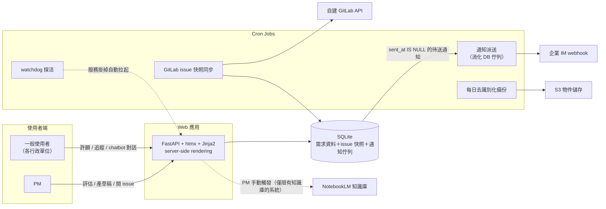
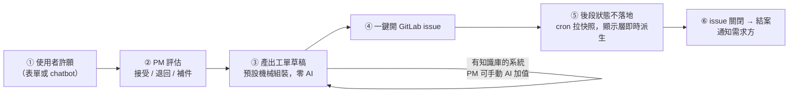
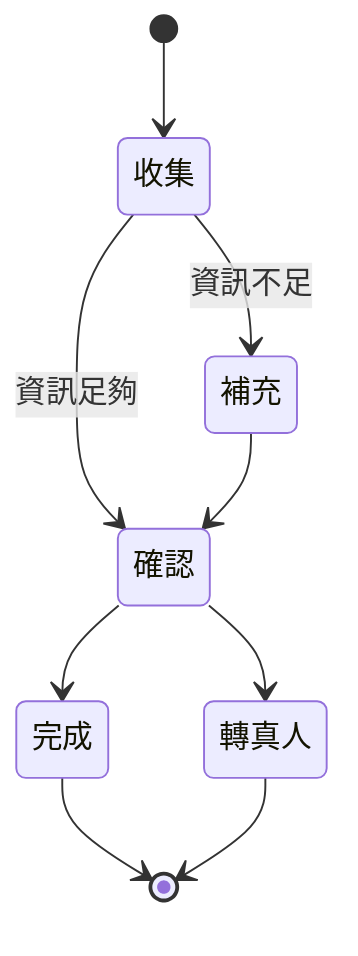

# 系統架構說明

本文件說明 Internal Request Hub 的整體架構、資料流、程式分層，以及九項核心設計決策。每項決策都先講「遇到什麼問題」，再講「怎麼解、為什麼這樣解」。

## 系統架構圖



幾個閱讀重點：

- **Web 應用只跟 SQLite 講話**，所有外部整合（GitLab、企業 IM、S3）都由 cron jobs 非同步處理。使用者請求路徑上沒有任何外部 API 呼叫，頁面回應速度不受外部服務健康度影響。
- **DB table 兼任通知佇列**：Web 端只負責「寫入一筆待送通知」，cron 負責送出。沒有 Redis、沒有 Celery。
- NotebookLM 是唯一的例外路徑：PM 在頁面上**手動**觸發草稿加值時才會同步呼叫（詳見[決策 a](#a-deterministic-為主ai-為輔)）。

## 資料流：一個需求的一生



前段（①～④）狀態由平台自己管理；**從 issue 建立那一刻起（⑤～⑥），GitLab 成為唯一真相源**，平台只存快照、不再維護自己的狀態欄位（詳見[決策 b](#b-後段不存狀態gitlab-是單一真相源)）。

## 程式分層

```text
routers/        # HTTP 進出口：解析請求、呼叫領域層、渲染 template
domain/         # 純函式領域層：狀態機、草稿組裝、狀態派生（不碰 DB/HTTP/ORM）
integrations/   # 整合封裝：GitLab API、企業 IM webhook、S3、NotebookLM
cron/           # 排程任務：快照同步、通知派送、備份、探活
```

| 層 | 職責 | 依賴規則 |
|---|---|---|
| routers | 接 HTTP、組 response、htmx partial 渲染 | 可以呼叫 domain 與 DB，不寫商業邏輯 |
| domain（純函式） | 所有「給定輸入必得同一輸出」的決策邏輯 | **禁止** import ORM、禁止碰 DB、禁止碰 HTTP |
| integrations | 每個外部系統一個封裝模組，收斂認證、重試、錯誤轉換 | 只被 routers 與 cron 呼叫 |
| cron | 把「該發生的副作用」實際做掉 | 呼叫 integrations，讀寫 DB |

這個分層的核心目的只有一個：**把「決策」和「副作用」拆開**。決策（domain）可以離線測、快速測；副作用（integrations/cron）薄到幾乎不需要測邏輯，只需要測接線。

---

## 設計決策

### a. Deterministic 為主、AI 為輔

**問題**：工單草稿如果全靠 LLM 生成，會有三個麻煩——輸出不可重現（同樣輸入每次長不一樣，PM 難以信任）、外部 AI 服務掛掉整個流程卡死、以及每一次產草稿都有 API 成本。

**解法**：草稿產生**預設走純機械組裝**——從需求表單欄位、系統設定、既有模板拼出草稿，零 AI 呼叫，同樣輸入必得同樣輸出。AI 只在一種情況出現：該系統有設定 NotebookLM 知識庫，且 PM 在頁面上**手動按下加值**，才呼叫一次 LLM 用知識庫內容補充草稿。呼叫失敗就降級回機械版草稿，流程照走、不阻塞。

換句話說：AI 是「PM 覺得有幫助時才開的加分題」，不是流程的必經節點，更不是單點故障。

### b. 後段不存狀態，GitLab 是單一真相源

**問題**：需求開成 GitLab issue 之後，開發進度（label、assignee、開關狀態）都活在 GitLab。如果平台自己也存一份「開發中／已完成」狀態，就變成雙寫：GitLab 改了、平台沒跟上，兩邊對不上時使用者看到的就是錯的進度。

**解法**：issue 建立後，平台**不再有自己的狀態欄位**。cron 定期把 issue 的原始資料拉回來存成**快照**（快照就只是快照，不做任何解讀），顯示層在渲染當下才從快照**即時派生**出使用者看得懂的狀態文案。

舉例：使用者頁面上的「開發中」不是 DB 裡某個 `status = 'developing'` 欄位，而是渲染時由「issue 還開著＋帶有某些 label」派生出來的。要改狀態顯示規則，只改派生函式一處，不需要跑資料 migration，也永遠不會有「派生規則改了但存量資料沒刷」的問題。

### c. 無 broker 佇列：DB table 就是佇列

**問題**：通知（例如「你的需求已被接受」推到企業 IM）需要非同步送出——不能讓使用者的頁面請求等一個外部 webhook。標準答案是 Redis + Celery，但那代表多兩個要部署、監控、升級的服務，對一個單人維運的內部平台是不成比例的負擔。

**解法**：一張通知 table 就是佇列。Web 端要發通知時只是 `INSERT` 一筆（`sent_at` 為 NULL）；cron 每次醒來撈 `WHERE sent_at IS NULL` 的紀錄逐筆送出，成功就回填 `sent_at`。

- 天然持久化：服務重啟通知不會丟（它就在 DB 裡）。
- 天然可觀測：`SELECT` 一下就知道積壓多少、卡在哪一筆。
- 天然冪等邊界：`sent_at` 回填即出隊，重跑 cron 不會重送。

以內部平台的通知量，這個設計的吞吐綽綽有餘，而換來的是**少維運兩個 middleware**。

### d. 純函式領域層

**問題**：核心邏輯（chatbot 狀態機怎麼轉、草稿怎麼組、狀態怎麼派生）如果和 ORM、DB session、HTTP request 攪在一起，單元測試就得起 DB、mock 一堆物件，測試又慢又脆，最後大家就不寫了。

**解法**：這三塊邏輯**刻意寫成純函式**——不 import ORM、不碰 DB、不碰 HTTP。輸入是普通的 dict／dataclass，輸出也是。routers 和 cron 負責「把資料撈出來餵給純函式，再把結果寫回去」。

效果：unit 測試可以**完全離線**執行，不需要 DB、不需要網路、不需要 mock 框架大戰，秒級跑完。狀態機的每一條轉移、草稿的每一種組裝分支，都是「餵輸入、驗輸出」一行搞定。

### e. 「隱形契約」測試

**問題**：htmx + Jinja 是無型別架構——template 裡寫一個 URL、一個 DOM id、一個事件名，Python 端改了，沒有任何編譯器會叫。實務上最常見的事故就是「改 A 靜默壞 B」：route 改了路徑，某個 template 裡的 `hx-get` 還指著舊的，畫面看起來正常，按下去才 404。

**解法**：把這些散落在跨檔之間、肉眼看不見的約定，明文寫成測試。共四類：

| 契約 | 兩端 | 壞掉的樣子 |
|---|---|---|
| template URL ↔ route | Jinja 裡的 `hx-get`/`hx-post` ↔ FastAPI route 定義 | 按鈕按下去 404 |
| HX-Trigger 事件字串 | Python 回傳的事件名 ↔ JS 監聽的事件名 | 後端有動作、前端沒反應 |
| 跨 template DOM id | htmx `hx-target` 指到的 id ↔ 另一個 template 裡實際的 id | swap 落空、畫面不更新 |
| 狀態派生 class ↔ CSS | 派生函式輸出的 class 名 ↔ CSS 裡定義的 class | 狀態顯示沒有樣式、變透明 |

這些測試不驗行為、只驗「兩端字串還對得上」，寫起來便宜，但把整類「靜默斷裂」從線上事故變成 CI 紅燈。

### f. 「改哪跑哪」影響地圖

**問題**：全套測試（unit + E2E）每次 commit 都跑一輪太慢；但讓開發者自己挑要跑哪些測試，一定會漏。

**解法**：維護一份 source→test 的對映（影響地圖）。CI 拿 git diff 的改動檔案清單對映出「這次該跑的測試集合」，只跑命中的部分。關鍵在 **fail-safe 方向**：如果有任何改動檔案**不在地圖上**，不是跳過，而是**退回跑全套**、並且在 CI 輸出點名「這些檔案沒有對映，請補地圖」。

也就是說：地圖完整時得到速度，地圖不完整時得到安全，永遠不會出現「因為忘了登記所以測試沒跑」的靜默漏洞。

### g. CI 設計

**問題**：單人專案最容易在 CI 上偷懶——直推 main、測試想到才跑，等到出事才發現保護網早就有洞。

**解法**：

- **main protected，一律走 MR**：即使全 repo 只有一個人，也強迫每次改動經過 pipeline 才能進 main。
- **每個 MR 跑全套 unit + E2E**：MR 是合併前最後一道關，這裡不做「改哪跑哪」的裁剪。
- **docs-only 改動自動跳過測試 job**：改 README 不需要等 E2E，用改動路徑判斷自動跳過，省時間也省 runner。
- **三 job 分離**：兩個硬閘（unit、E2E，紅了就不能合）＋一個情報 job（`allow_failure`，例如 lint 或影響地圖的健康報告）。硬閘保正確性，情報 job 提供訊號但不擋路——避免「為了讓 CI 過而去修跟這次改動無關的東西」。

### h. 維運自曝

**問題**：單人維運的系統，最貴的成本是「出事了但沒人知道」。同步默默失敗三天，使用者看到的是三天前的狀態，卻沒有任何人收到警訊。

**解法**：讓系統自己把健康狀態說出來，三個機制：

1. **同步健康度寫回 DB、顯示在設定頁**：每輪 GitLab 快照同步的結果（成功時間、失敗原因）落地，PM 打開設定頁就看得到「上次同步是什麼時候、有沒有掛」。不需要登進主機看 log。
2. **watchdog 探活自動拉起**：排程定期探測服務是否存活，掛了就自動重啟，並留下紀錄。
3. **每日去識別化備份**：每天產出備份包上傳 S3；備份內容經過去識別化處理，且**不含任何 key/token**——備份包外流時的災損被限制在最小。

### i. chatbot 對話狀態機

**問題**：使用者不一定會來開網頁填表單——很多需求是在企業 IM 裡順口講的。要接住這些輸入，得在 IM 裡放一個 bot 引導使用者把需求講完整；而對話式互動最容易寫成一坨 if-else 義大利麵。

**解法**：把對話收斂成一個明確的狀態機（示意）：



實作上的三個要點：

- **webhook 收訊、純函式決策**：IM webhook 進來後，router 只負責撈出目前對話狀態，交給純函式 `decide(state, message) -> (new_state, actions)` 決定下一步；決策本身不碰 DB、不碰 HTTP（見[決策 d](#d-純函式領域層)），每條狀態轉移都有離線單元測試。
- **轉真人時附件轉存 S3**：對話升級成真人處理時，使用者在 IM 裡傳過的附件會轉存到 S3，避免之後 IM 訊息過期、附件跟著消失。
- **降級不中斷**：附件抓不到（過期、權限、網路）時，不讓整個轉真人流程失敗，降級成「附上檔名提示」讓真人知道曾有這個附件、可向使用者再要一次。
