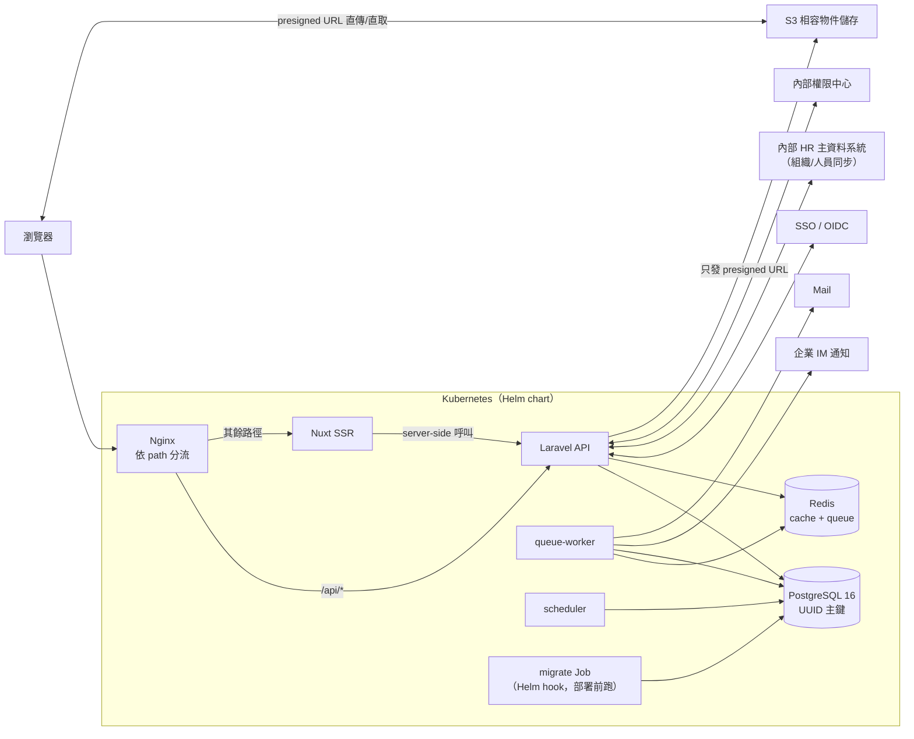
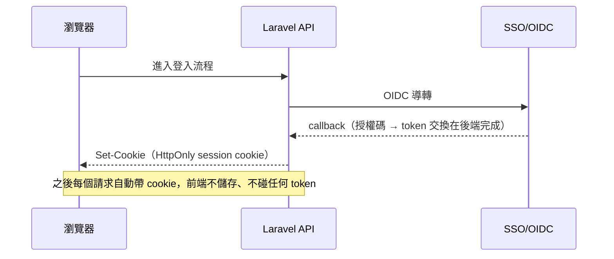
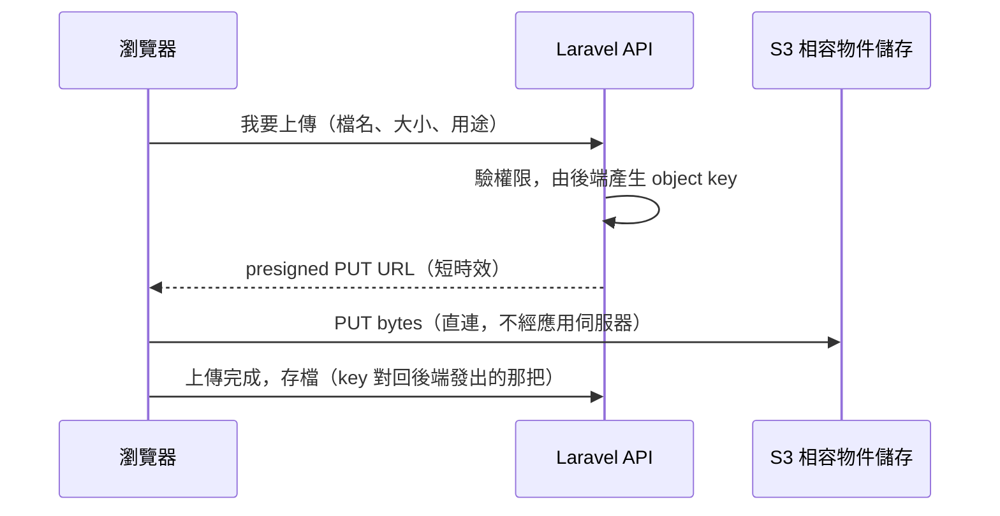

# 系統架構

本文件說明 Learning Platform（公司內部教育訓練平台）的整體架構與主要設計決策。每個決策都用同一個格式：**先講遇到什麼問題，再講怎麼解**。

## 整體架構圖

重點：

- **單一入口**：瀏覽器只面對 Nginx 一個 origin，依 path 分流到 Nuxt SSR 或 Laravel API。
- **檔案 bytes 不進 K8s**：上傳/下載都走 presigned URL 直連物件儲存，應用伺服器只負責發 URL。
- **背景工作分離**：通知、重活都丟 queue 由 queue-worker 消化；排程由獨立 scheduler pod 觸發。
- **migration 自動化**：Helm hook 的 migrate Job 在每次部署前自動跑，人不會忘。

## 三條核心資料流

### ① 登入（cookie，不是 Bearer token）

### ② API 每個 endpoint 再驗角色

前端的選單、按鈕依角色顯示只是「體驗」，不是「防線」。每一個 API endpoint 在後端都重新驗一次：這個 session 的使用者，有沒有這個資源、這個動作的角色權限。直接打 API 繞過畫面，得到的是 403，不是資料。

### ③ 檔案 presigned 直傳，bytes 不經後端

下載反向同理：後端發短時效 presigned GET URL，瀏覽器直連取檔。

## 設計決策

### a) BFF 架構：Nginx 依 path 分流，身分走 cookie

**問題**：前後端分離常見做法是前端存 Bearer token 再帶在 header 打 API。token 放 localStorage 就有 XSS 竊取風險，放記憶體則重整就掉；而且前後端跨 origin 還要處理 CORS。

**解法**：Nginx 單一 server block 依 path 分流——`/api` 開頭進 Laravel，其餘全進 Nuxt SSR。對瀏覽器來說前後端是同一個 origin，身分一律用 HttpOnly cookie：JavaScript 讀不到、請求自動帶上，前端程式碼裡完全沒有 token 管理這件事。CORS 問題也一併消失。

### b) S3 presigned 直傳/直取：bytes 不經應用伺服器

**問題**：LMS 的大宗流量是教學影片和講義附件。如果上傳下載都經過 Laravel，等於用最貴的資源（應用伺服器的 worker）搬最笨的東西（檔案 bytes），大量使用者同時看影片會先把後端打死。

**解法**：

- 上傳/下載一律走 presigned URL 直連物件儲存，應用伺服器只負責「驗權限＋發 URL」。
- **object key 一律由後端產生**，不信任前端傳來的任何路徑——前端能決定 key 就能覆蓋別人的檔案。
- 下載用**短時效 presigned GET**：連結轉貼出去很快就失效，作為外流嚇阻。
- **每週 GC** 掃描並回收孤兒物件（上傳了但沒有任何資料列引用的檔案），並設寬限期保護「剛 PUT 完、還沒呼叫存檔 API」的正常流程不被誤刪。

### c) 去原生 ENUM → varchar + CHECK

**問題**：PostgreSQL 原生 enum 型別要新增或改值都得 `ALTER TYPE`，還有交易內限制與孤兒型別等維運坑。狀態欄位在產品迭代中偏偏是最常改的東西。

**解法**：全部改為 `varchar + CHECK` 約束。改值只要 drop/add 一條 constraint，是普通 DDL。

配套的關鍵不是改型別本身，而是**測試釘死行為**：對每一個這類欄位，測試驗證三件事——CHECK 約束存在、所有合法值寫得進去、非法值全部被擋。換型別時要特別注意：原本由 DB enum 隱含擋下的非法值，換成 varchar 後若沒有 CHECK 就不再被擋，所以每一欄都要明確定好驗證責任。測試逼著把每一欄都看過一遍。

### d) 時區慣例：UTC 存、當地產生顯示字串

**問題**：伺服器、DB、使用者三方時區一旦不一致，`timestamptz` 比較就可能默默差好幾個小時，而且 bug 只在特定時段浮現，極難追。

**解法**：

- `app.timezone` **保持 UTC**，所有儲存與比較都在 UTC 上做。
- 排程另外設 `schedule_timezone` 為當地時區，「每天早上發提醒」這種需求照當地時間跑，不用在 cron 表達式裡自己換算。
- 顯示字串（信件、通知內文的日期時間）由後端從當地時區產生，前端拿到的是已經正確的字串，不再各自換算。

### e) i18n runtime 字串同步

**問題**：文案改一個字就要重新打包部署，HR 無法自己調整措辭；但字串全放 DB，DB 或字串服務一掛，畫面就開天窗。

**解法**：文案存 DB，前端在開機與切換語系時拉 API，用 `mergeLocaleMessage` 把 DB 字串**蓋在打包內建的後備字串上**。降級路徑很明確：字串 API 掛掉、DB 掛掉，都退回打包時的字串——畫面永遠有字，絕不白畫面。另有 CI job 自動比對 locale JSON 的差異、產生字串匯入批次，讓「程式碼裡新增 key」和「DB 裡有對應字串」不會脫鉤。

### f) CI 三段閘門 fail-fast

**問題**：真實事故——一支 queue job 重宣告了 trait 已有的屬性，這在 PHP 是**載入期 fatal**：`php -l` 語法檢查抓不到（單檔語法完全合法），單元測試也沒有任何 case 會去 new 那個 class，於是它無聲地 merge 進了 main。

**解法**：CI 前段設三道 fail-fast 閘門，越便宜的越先跑：

1. `php -l` — 逐檔語法檢查，秒級。
2. **class 載入 smoke** — 強制 autoload 專案裡**每一個 class**。trait 屬性衝突、interface 沒實作完這類「檔案合法、載入即炸」的錯誤，在這關現形。
3. 全測 — 前兩關都過才花時間跑完整測試。

第 2 關就是為那次事故補上的：它不驗任何行為，只驗「每個 class 都能被載入」，成本極低，但正好蓋住前後兩關之間的盲區。

### g) E2E 套件：Playwright，「改哪跑哪」

**問題**：E2E 全套數十支 spec、數百個 test，全跑一輪很久。每個 MR 都全跑，CI 排隊會拖垮迭代節奏；但憑感覺挑著跑，漏掉的那支往往就是會炸的那支。

**解法**：

- **Hermetic**：套件與前端專案完全隔離，自備測試資料與環境，不依賴任何共用狀態，任何機器 clone 下來就能跑。
- **spec-map「改哪跑哪」**：由 git diff **靜態**算出這次改動觸及哪些頁面/元件，映射到該跑的 spec 子集。
- **Fail-safe**：diff 落在 map 覆蓋不到的地方（共用層、設定檔）就直接**全套跑**——寧可慢，不可漏。
- **Stale 檢查**：spec 依賴 `data-testid` 選取元素；有 `data-testid` 被刪改時，檢查還有哪些 spec 在引用它，讓「改了畫面忘了改測試」在 CI 就被點名。
- **兩種 CI job**：每次 push 跑秒級的 **warn-only 報告 job**（只算該跑哪些、不真跑）；真跑是**手動觸發 job**，用 `resource_group` 互斥避免多條 pipeline 搶同一套測試環境。

### h) 通知 best-effort

**問題**：IM 或 Mail 服務偶爾會慢或掛。如果通知失敗會讓「指派課程」這種業務動作跟著 rollback 或報錯，等於讓外部服務的可用性綁架核心功能。

**解法**：

- 所有通知走 `afterCommit` 才入 queue——交易沒成功就不會發通知，不會出現「收到通知但資料其實沒寫進去」。
- 通知失敗**不影響業務動作**：業務資料已 commit，通知自己重試或認賠，頂多少一封信，不會少一筆派課。
- **開發環境安全閘門**：非正式環境的所有通知一律改寄到受控測試帳號，並在內文標註原收件人——測試時絕不會誤發真人。

### i) 安全紅線

幾條不妥協的原則：

- **完課判定在後端**：前端只回報事件（影片心跳、測驗作答），「這個人完課了沒」由後端依規則判定。前端說了不算——改 JavaScript 不能讓自己完課。
- **每個 endpoint 再驗角色**：藏按鈕只是 UX，授權判斷在每個 API 上重做一次（見資料流②）。
- **重要操作留 audit log**：派課、改成績、改權限這類操作記錄何人、何時、對誰、改了什麼。
- **不自建密碼**：身分全部交給 SSO/OIDC，系統裡沒有密碼欄位，也就沒有密碼外洩這個風險類別。
- **稽核記真實 IP**：流量經過 proxy 層，audit log 裡的來源 IP 用 nginx `real_ip` 還原，不然記到的全是 proxy 自己。

### j) 部署：Helm chart 一包到位

**問題**：手動部署的每一步都是一次忘記的機會，其中最痛的是忘跑 migration——程式碼是新版、schema 是舊版，上線即炸。

**解法**：Helm chart 包含全部元件：`fe`（Nuxt SSR）、`be`（Laravel API）、`queue-worker`、`scheduler`、`redis`、`ingress`，外加一個 **migrate Job**——用 Helm hook 掛在部署前，每次 `helm upgrade` 自動先跑 migration，成功才滾動更新應用。migration 從「要記得的步驟」變成「流程的一部分」，人為失誤直接歸零。
